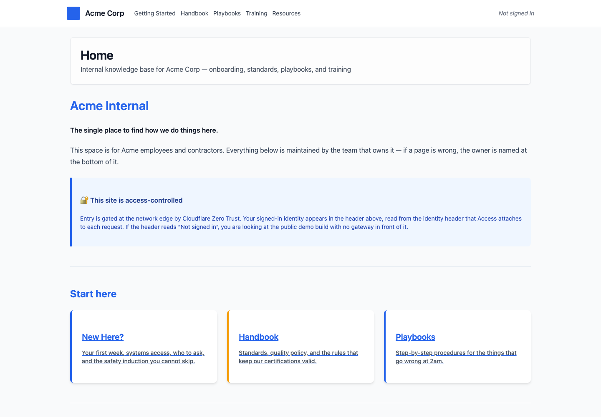
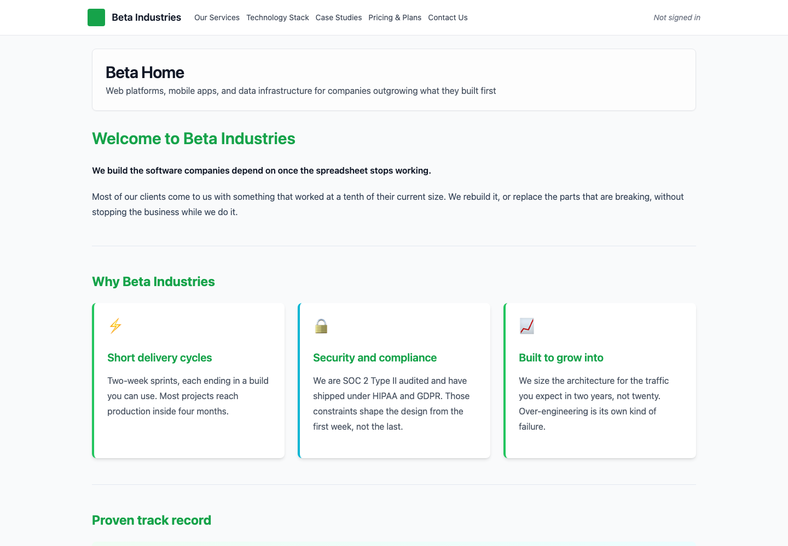

# Client Sites

Serve several client sites from one Astro codebase. Each hostname selects its own
MDX content, navigation, logo, and colors, while the layout and deployment stay shared.

**[Explore the demo](https://multi-client-astro.pages.dev)** ·
[Knowledge base](https://multi-client-astro.pages.dev/?as=acme) ·
[Marketing site](https://multi-client-astro.pages.dev/?as=beta)

| Knowledge base | Marketing site |
| --- | --- |
|  |  |

Screenshots show the public demo's fictional example tenants. Acme demonstrates
a knowledge base and Beta a marketing site; both are publicly accessible here.

- Hostname routing selects the tenant without separate application builds.
- MDX pages supply content and navigation, checked against a frontmatter schema.
- Astro SSR runs on Cloudflare Pages; Cloudflare Access can protect private tenants.

## Run locally

Requires Node 20.3+ and pnpm 10.33.2 (pinned in `package.json`).

```sh
pnpm install
pnpm dev
```

Open [Acme](http://localhost:4321/?as=acme) or
[Beta](http://localhost:4321/?as=beta). Local development needs no environment variables.

## Deploying private sites

Tenant routing is separate from access control. Protect every reachable hostname,
including `*.pages.dev`, with Cloudflare Access. The `?as=` override works locally;
on Pages hosts it requires `ALLOW_TENANT_OVERRIDE=true`, and custom domains never
honor it. Leave the flag off unless every tenant is public. The displayed Access
identity is not an authorization check.

The [full guide](GUIDE.md) retains tenant setup, content, theming, deployment,
security limits, and development commands. Start with [CONTRIBUTING.md](CONTRIBUTING.md)
to contribute; run `pnpm lint`, `pnpm typecheck`, `pnpm test`, and `pnpm build`.

[MIT license](LICENSE).
